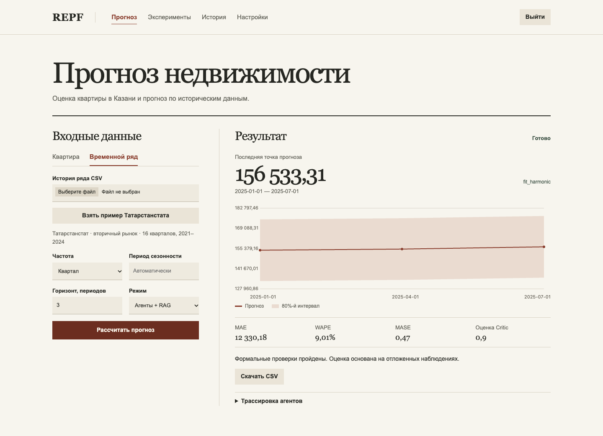
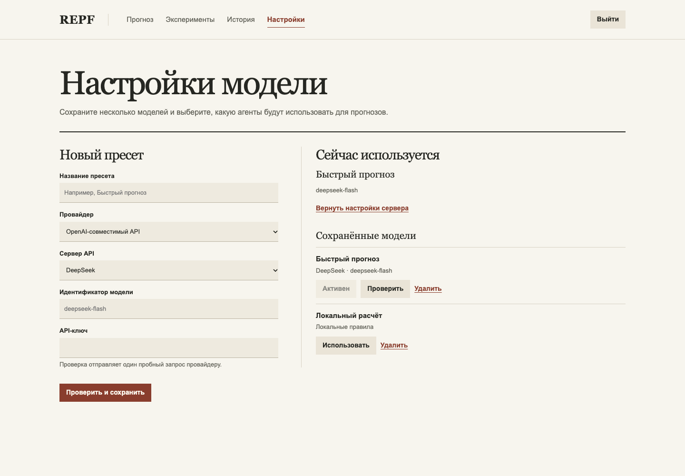

# REPF · прогноз недвижимости

REPF оценивает стоимость квартиры на вторичном рынке Казани и строит прогноз по загруженному ряду. Агенты анализируют вход, подбирают модель по похожим кейсам, проверяют прогноз и при необходимости запрашивают решение человека.

Для оценки квартиры можно загрузить собственную историю продаж. В демонстрационном режиме используются синтетические квартиры. В разделе временных рядов есть открытый квартальный пример Татарстанстата за 2021–2024 годы.

## Быстрый старт

Установите **Python 3.12** и откройте терминал в папке проекта `repf`, где находится `run.py`. Для первого запуска понадобится доступ к PyPI. Пример прогноза работает с локальными правилами.

### macOS и Linux

```bash
bash scripts/bootstrap.sh
```

### Windows · PowerShell

```powershell
py -3.12 -m venv .venv
.\.venv\Scripts\python.exe -m pip install -r requirements-dev.txt
if (!(Test-Path .env)) { Copy-Item .env.example .env }
.\.venv\Scripts\python.exe -m scripts.generate_knowledge_base
.\.venv\Scripts\python.exe -m scripts.import_data
.\.venv\Scripts\python.exe run.py
```

Дождитесь сообщения `Uvicorn running` и откройте [127.0.0.1:8000](http://127.0.0.1:8000). Создайте аккаунт, затем запустите прогноз квартиры или откройте «Временной ряд» и выберите пример Татарстанстата. Первый запуск готовит SQLite, 1168 кейсов и 500 записей справочника.

Для следующих запусков из той же папки выполните `.venv/bin/python run.py` на macOS/Linux или `.\.venv\Scripts\python.exe run.py` на Windows. Остановить сервер можно через `Ctrl+C`. [Инструкции и диагностика запуска](docs/DEPLOYMENT.md#локальная-установка)

Документация OpenAPI доступна на [127.0.0.1:8000/docs](http://127.0.0.1:8000/docs).

## Настройки модели

После входа откройте «Настройки». Для каждого пресета укажите название, провайдера, точный идентификатор модели и, при необходимости, API-ключ. DeepSeek доступен в списке серверов OpenAI-совместимого API. Нажмите «Проверить и сохранить», затем «Использовать» рядом с нужным пресетом. Агенты возьмут его для следующих задач в режиме «Агенты + RAG».

Настройки `.env` задают конфигурацию сервера по умолчанию. [Провайдеры и хранение ключей](docs/DEPLOYMENT.md)

## Как выглядит REPF

**Прогноз по квартальным данным Татарстанстата**



**Настройки с несколькими сохранёнными моделями**



## Docker

Скопируйте `.env.example` в `.env`, если файла ещё нет. Задайте `POSTGRES_PASSWORD` и `JWT_SECRET_KEY`. Команда запуска одинаковая для macOS, Linux и Windows с установленным Docker Compose.

```bash
docker compose up --build -d
```

После инициализации интерфейс доступен на [localhost:8080](http://localhost:8080). Compose поднимает FastAPI, Celery worker и beat, PostgreSQL, Redis, Qdrant и Nginx. Ollama запускается отдельным профилем. [Инструкция запуска и диагностики](docs/DEPLOYMENT.md)

## Что проверить на демонстрации

1. Запустите оценку квартиры. В результате появятся цена в рублях и за м², 80%-й интервал, факторы и результат проверки.
2. Откройте вкладку «Временной ряд», загрузите пример Татарстанстата и прогноз на три квартала. Проверьте дерево шагов и выгрузку CSV.
3. В «Экспериментах» сравните базовый режим, RAG и полный цикл. В разделе «История» можно открыть расчёт снова и отфильтровать очередь HITL.

## Документация

| Документ | Содержание |
|---|---|
| [Тема](docs/topic.md) | Изначальная постановка задачи и границы предметной области |
| [Архитектура](docs/ARCHITECTURE.md) | Агенты, реестр моделей, RAG, фоновые задачи, схема данных |
| [Данные](docs/DATA.md) | Источники, форматы загрузки и генерация базы знаний |
| [API](docs/API.md) | Авторизация, прогноз, трассировка, HITL и оценка |
| [Развёртывание](docs/DEPLOYMENT.md) | macOS, Linux, Windows, настройки моделей, Docker и диагностика |
| [Отчёт](docs/REPORT.md) | Методика, результаты, графики и ограничения |
| [Журнал разработки](docs/WORK_LOG.md) | Ход работ и состояние проверок |
