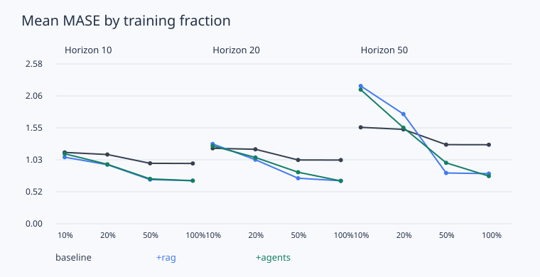
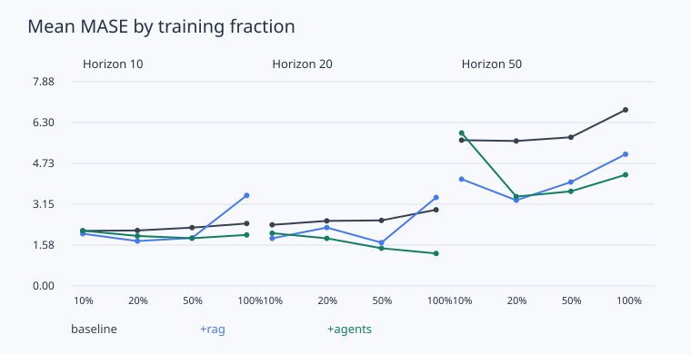

# Оценка качества REPF

## Эксперимент

Для каждого ряда последние 10, 20 или 50 точек были отложены до запуска моделей. Обучение использовало последние 10%, 20%, 50% или 100% оставшейся истории. Все режимы получали одинаковые временные срезы. Внутренний выбор модели и диагностика использовали только доступную историю. Для ряда Татарстанстата из 16 точек использованы горизонты 1, 2 и 4 квартала и вся доступная история.

База похожих случаев содержит 1168 кейсов, сформированных отдельно. Синтетические тестовые ряды сгенерированы с seed 5003, а корпус с seed 2004. Открытые ряды Татарстанстата и Macrodata целиком оставлены для оценки. Конфигурации синтетики на 20, 50 и 100 рядах вложены друг в друга. [Источники и признаки](DATA.md)

Сценарий проверял базовый сезонный прогноз, подбор модели по аналогам и полный цикл агентов. Во всех пакетных прогонах LLM была заменена детерминированным mock-провайдером, а статистическая диагностика остатков ограничивалась ACF. Этот режим воспроизводится с помощью флага `--lightweight-stats`. Токены не расходовались. Результаты измеряют влияние поиска и агентного цикла с указанной конфигурацией.

## Результаты на 100 синтетических рядах

MASE при использовании 100% доступной истории. Меньше означает лучшую точность.

| Горизонт | Baseline | Подбор по аналогам | +Agents | WAPE +Agents |
|---:|---:|---:|---:|---:|
| 10 | 0,971 | 0,694 | 0,694 | 5,73% |
| 20 | 1,026 | 0,693 | 0,690 | 5,51% |
| 50 | 1,273 | 0,808 | 0,768 | 6,17% |

На длинном горизонте подбор по аналогам снизил MASE с 1,273 до 0,808, полный цикл — до 0,768. При усреднении по всем долям и горизонтам подбор по аналогам показал 1,065, полный цикл — 1,067. Преимущество дополнительных итераций зависит от длины истории и горизонта. При 10% истории средний MASE у базового режима составил 1,306, а у подбора по аналогам и полного цикла — 1,526 и 1,514. На короткой истории выбор более сложной модели иногда ухудшает прогноз.



Объём обучения влияет на доступность сезонных лагов. MASE использует сезонный шаг при наличии хотя бы одной пары точек такого лага, иначе применяется лаг 1. При сравнении долей это меняет знаменатель на части рядов. MAE и WAPE по тем же срезам доступны в таблицах.

| Рядов | Количество расчётов | Baseline, средний MASE | Подбор по аналогам | +Agents |
|---:|---:|---:|---:|---:|
| 20 | 720 | 1,162 | 1,030 | 1,022 |
| 50 | 1800 | 1,147 | 1,052 | 1,046 |
| 100 | 3600 | 1,192 | 1,065 | 1,067 |

Среднее рассчитано по 12 комбинациям горизонта и доли данных. [20 рядов](results/synthetic_20.csv), [50 рядов](results/synthetic_50.csv), [100 рядов](results/synthetic_100.csv)

## Проверка на открытых данных

На 12 рядах Macrodata сравнили 432 расчёта. Для полной истории на горизонте 20 средний MASE составил 2,937 у базового режима, 3,413 у подбора по аналогам и 1,252 у полного цикла. На горизонте 50 полный цикл также получил меньший MASE, однако его WAPE составил 35,49% против 33,12% у базового режима. Различие связано с тем, что метрики нормируют ошибки по разным знаменателям. [Выгрузка](results/macro.csv)



| Горизонт Татарстанстата | Baseline, WAPE | Подбор по аналогам, WAPE | +Agents, WAPE |
|---:|---:|---:|---:|
| 1 квартал | 12,03% | 1,31% | 1,31% |
| 2 квартала | 8,74% | 6,61% | 6,61% |
| 4 квартала | 5,14% | 9,49% | 9,49% |

На горизонте четырёх кварталов наивная сезонная модель оказалась точнее. Один ряд и 16 точек дают локальный пример, а не оценку качества для рынка в целом. Табличная оценка квартир проверена на временном разбиении синтетической истории и в интеграционном тесте. Для оценки точности на реальных сделках нужна отдельная история квартир Казани. [Татарстанстат, результаты](results/tatarstan.csv)

## Парные проверки

На 100 синтетических рядах при полной истории сравнили разности MASE для базового и полного режимов. Положительная разность означает преимущество полного цикла.

| Горизонт | Bootstrap 95% для разности | Wilcoxon p |
|---:|---:|---:|
| 10 | 0,206–0,348 | 8,89 × 10⁻¹¹ |
| 20 | 0,259–0,416 | 7,01 × 10⁻¹⁵ |
| 50 | 0,351–0,688 | 9,27 × 10⁻¹⁴ |

Bootstrap повторно выбирает парные разности по рядам. Wilcoxon в сохранённом прогоне использовал нормальную аппроксимацию рангов с учётом связок. Выгрузка также содержит результаты расчёта Diebold–Mariano с HAC-оценкой дисперсии, пропуская вырожденные и короткие последовательности ошибок. Оценка DM здесь описательная, поскольку потери внутри одного отложенного окна относятся к разным шагам прогноза. Показатели Macrodata могут быть зависимы. Интервалы и p-value приведены без поправки за множественные сравнения. [Парные сравнения](results/pairwise.csv)

## Стоимость и траектории

| Режим, 100 рядов | Среднее время | Итерации | HITL | LLM-токены |
|---|---:|---:|---:|---:|
| Baseline | 8,06 мс | 1,00 | 0% | 0 |
| Подбор по аналогам | 11,20 мс | 1,00 | 0% | 0 |
| +Agents | 11,71 мс | 1,23 | 7,8% | 0 |

Среднее время относится к расчёту одного эксперимента после загрузки индекса. Стоимость HTTP, очередь и операции интерфейса сюда не входят. На Macrodata полный цикл потребовал в среднем 1,56 итерации и отправил 18,1% прогнозов на проверку. Точные токены и время DeepSeek сохраняются при реальном вызове провайдера. В отчёте измерений с реальным DeepSeek нет.

## Повторение

Сначала подготовьте окружение по [инструкции запуска](DEPLOYMENT.md#локальная-установка). Команды ниже приведены для macOS и Linux. В PowerShell замените `.venv/bin/python` на `.\.venv\Scripts\python.exe` и оставьте аргументы без изменений.

```bash
.venv/bin/python -m scripts.generate_knowledge_base
.venv/bin/python -m scripts.run_eval --lightweight-stats --num-series 100 --output data/processed/eval_synthetic.json
.venv/bin/python -m scripts.run_eval --lightweight-stats --dataset macro --num-series 12 --output data/processed/eval_macro.json
.venv/bin/python -m scripts.run_eval --lightweight-stats --dataset tatarstan --num-series 1 --horizons 1 2 4 --data-fractions 1 --output data/processed/eval_tatarstan.json
```

Каждый запуск сохраняет JSON с разбивкой по рядам, сводную CSV, изображение SVG и лог. Для оценки настроенного провайдера доступен флаг `--configured-llm`. Интервалы будущей цены калибруются на отложенных остатках внутри задачи. Покрытие, показываемое в результате, относится к калибровочным остаткам, поэтому не оценивает частоту попадания для будущего рынка.
